# Winsland

Dynamic Island для Windows: живая «бровь» вверху экрана с плеером, погодой, полкой для файлов, записью экрана, снимками с разметкой, Gemini и плагинами.

## Остров

Наведите курсор на бровь, и она раскроется. Сверху вкладки, их можно переставлять: зажмите вкладку и перетащите.

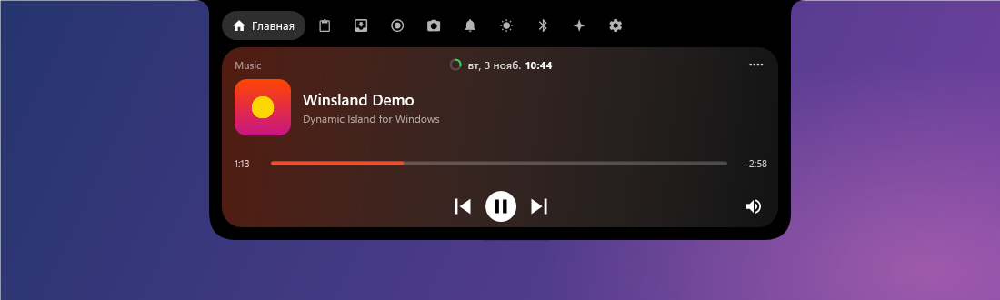

**Погода** с прогнозом по часам, на три дня и с восходом и закатом:

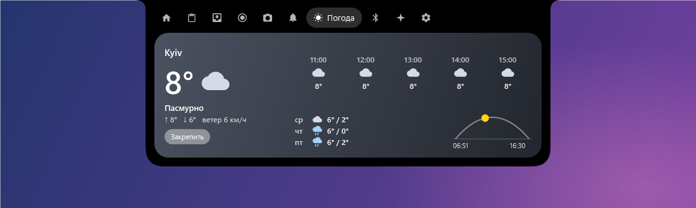

**Полка для файлов**: перетащите файл на остров, а потом вытяните его в любое окно.

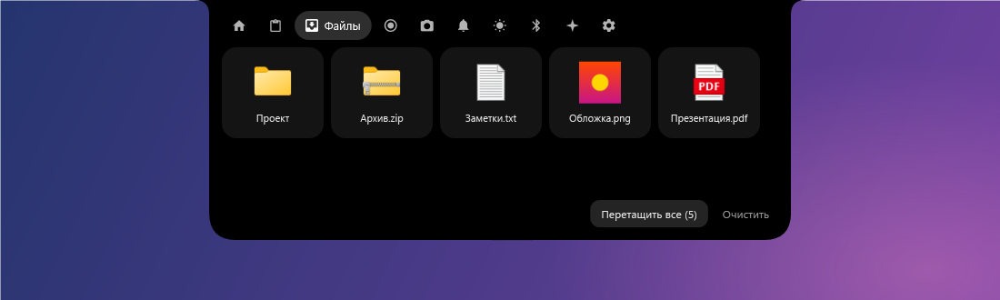

## Стили

Black, Material 3, Liquid Glass, Радужный, Матрица и свой цвет.

| | |
|---|---|
| 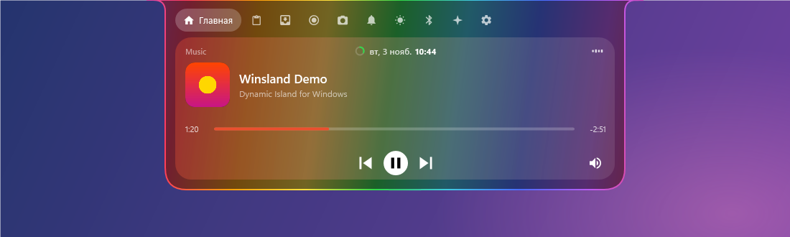 | 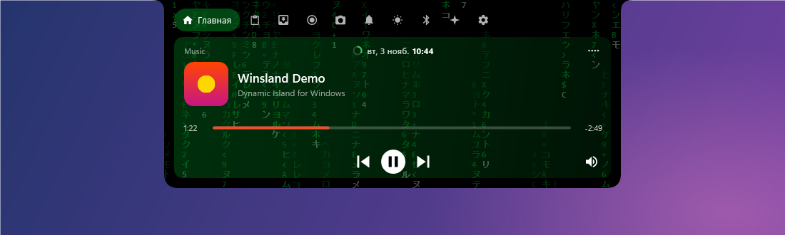 |
| 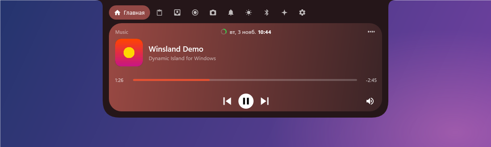 | 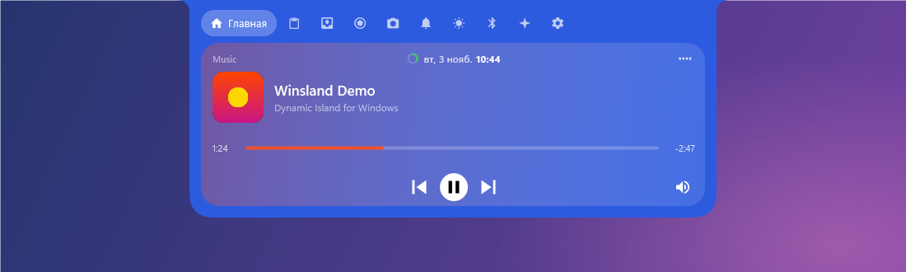 |

## Игровой режим

Пока на весь экран открыта игра, остров сжимается в маленькую капельку и не мешает. Двойное нажатие открывает его.

## Приложение

Все настройки по разделам: кастомизация острова, анимации, производительность, запись экрана, напоминания, глобальные настройки, обновления и плагины. Язык: русский, українська, English.

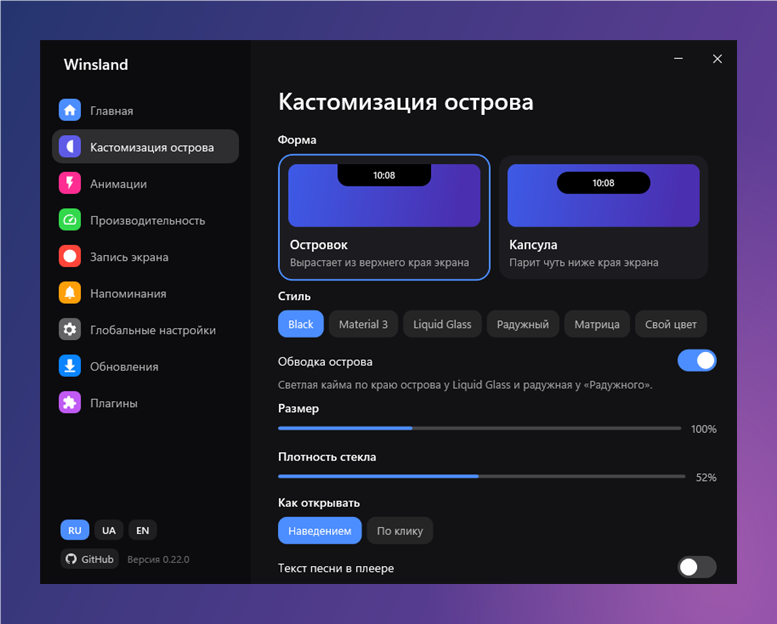

| | |
|---|---|
| 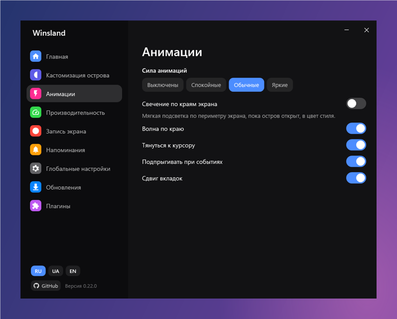 | 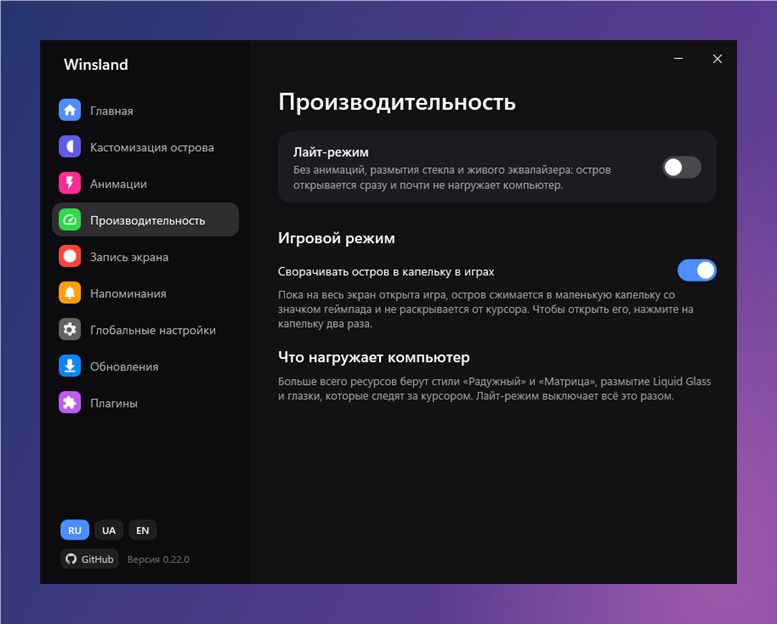 |

## Установка

Скачайте `Winsland-win-Setup.exe` со страницы [последнего релиза](https://github.com/delltrxxxx-hub/winsland/releases/latest) и запустите.

Новые версии Winsland находит сам при каждом запуске и предлагает установить:

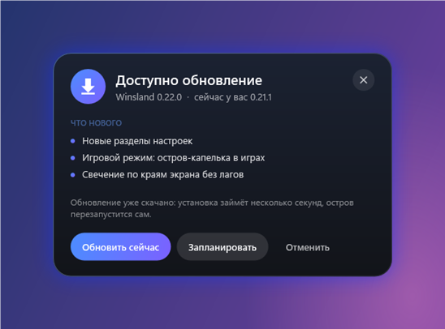

Установщик не подписан, поэтому Windows может показать предупреждение SmartScreen. Его можно пропустить через «Подробнее» → «Выполнить в любом случае».

В этом репозитории находятся только готовые версии приложения. На снимках демонстрационные данные.
